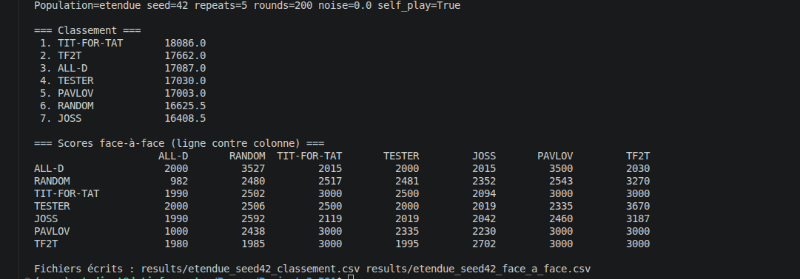
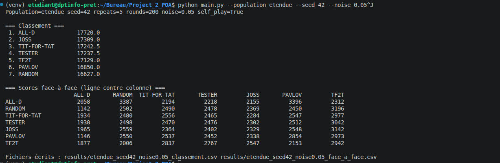
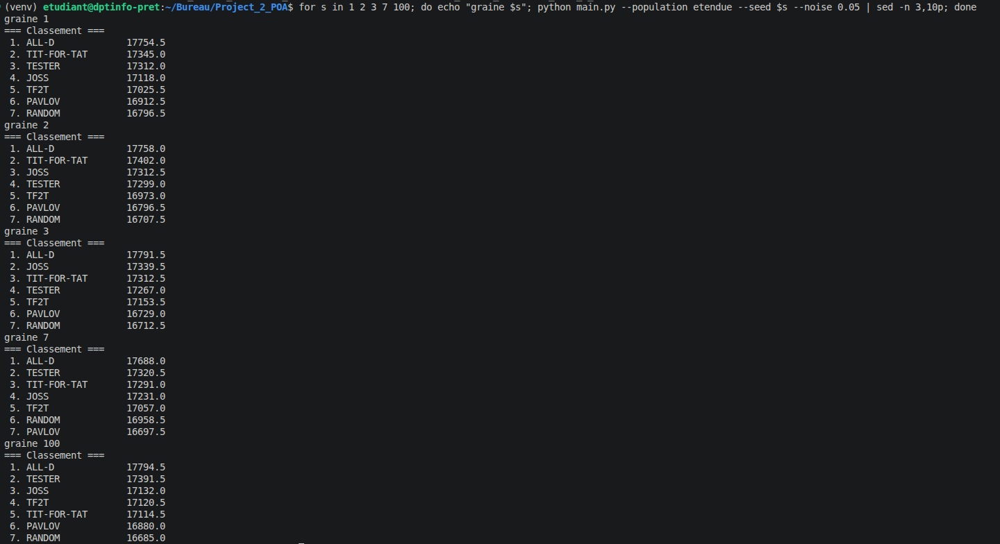
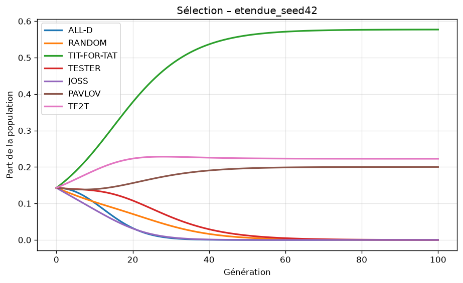
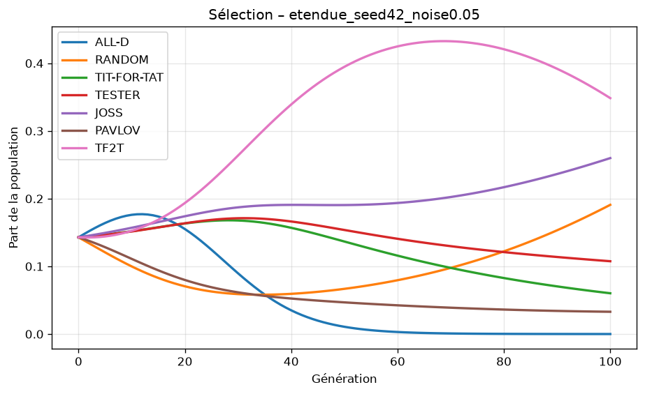
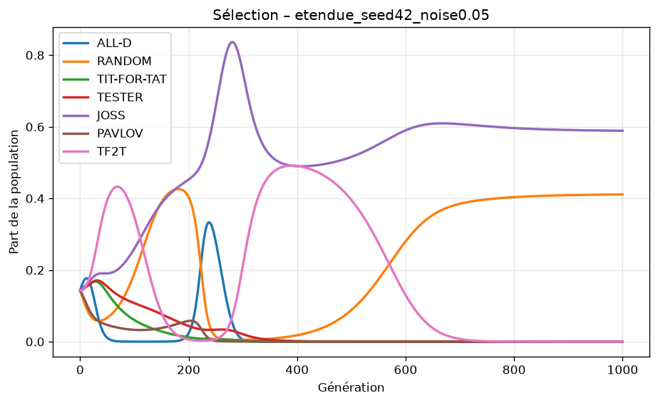

# Journal de bord – Projet 2 (HAI716I)
 
## Protocole
- Tours par partie : 200
- Parties par paire : 5
- Graine aléatoire : 42 (pour que les résultats soient reproductibles )
- Self-play : activé.
Chaque stratégie joue aussi contre son double, comme dans le tournoi d’Axelrod. Ça représente le fait qu’un agent peut rencontrer des agents qui lui ressemblent.
Ce choix compte beaucoup : les stratégies gentilles gagnent beaucoup contre elles-mêmes (TIT-FOR-TAT contre TIT-FOR-TAT = 3 000 points, coopération totale), alors qu’ALL-D gagne peu contre lui-même (2 000 points, trahison totale).
J’ai testé les deux versions :avec self-play, TIT-FOR-TAT gagne ; sans self-play, ALL-D gagne. Le gagnant dépend donc d’un simple choix de protocole.
J’ai gardé le self-play pour la suite, parce que c’est le format d’Axelrod et que la sélection (étape 3) en a besoin : une stratégie qui se multiplie rencontre forcément ses copies.


- Gains : CC = 3/3, CD = 0/5, DC = 5/0, DD = 2/2 (matrice du CM4).

## Stratégies
 
### ALL-D
- Règle : joue D à chaque tour, quoi que fasse l'adversaire.
- Origine : C'est le choix « rationnel » du dilemme
  joué une seule fois : trahir rapporte toujours plus, quoi que fasse l'autre.
- Devrait bien jouer contre :les stratégies imprévisibles comme RANDOM,
  car il gagne 5 points chaque fois que l'autre coopère.
- Devrait mal jouer contre : les stratégies qui réagissent à la trahison comme TIT-FOR-TAT, TESTER et JOSS ,ils se laissent tromper une seule fois puis trahissent aussi. Ainsi, ALL-D ne peut plus obtenir que 2 points par tour, contre 3 points lorsque les deux joueurs coopèrent.

### RANDOM
- Règle : à chaque tour, coopère avec une probabilité de 0,5 et trahit sinon,
  sans tenir compte de l'adversaire.
- Origine : Axelrod l'avait ajoutée à son tournoi de 1980
  comme point de comparaison , c'est comme une stratégie " sans intelligence " .
- Devrait bien jouer contre : Il peut gagner quelques points
  contre les stratégies qui coopèrent (il les trahit une fois sur deux).
- Devrait mal jouer contre : ALL-D, qui l'exploite chaque fois qu'il coopère
  (0 point pour RANDOM, 5 pour ALL-D)
  
### TIT-FOR-TAT
- Règle : coopère au premier tour, puis rejoue le dernier coup de l'adversaire.
- Origine : CM4 , la plus simple du tournoi , proposée par Anatol Rapoport, gagnante du tournoi d'Axelrod
- Devrait bien jouer contre : les stratégies gentilles et contre elle-même (3 points par tour).
- Devrait mal jouer contre :ALL-D (perd le premier tour) et JOSS (une trahison surprise lance un écho de vengeance)
### TESTER
- Règle : D au premier tour. Si l'adversaire riposte (joue D), TESTER joue TIT-FOR-TAT jusqu'à la fin ; sinon il répète C, C, D.
- Origine : CM4, stratégie soumise au tournoi d'Axelrod.
- Devrait bien jouer contre :les naïfs qui ne ripostent jamais : il les trahit un tour sur trois.
- Devrait mal jouer contre : Face à TIT-FOR-TAT, il trahit au premier tour. TFT riposte, puis TESTER, devenu TFT, imite cette riposte. Les deux stratégies entrent alors dans un cycle de représailles alternées (D, C, D, C…). Face à lui-même, les deux joueurs trahissent dès le premier tour, puis reproduisent indéfiniment la trahison de l'autre.
### JOSS
- Règle : TIT-FOR-TAT, mais remplace C par D une fois sur dix.
- Origine : CM4, soumise par Johann Joss au tournoi d'Axelrod.
- Devrait bien jouer contre : RANDOM et les stratégies qui ne ripostent pas.
- Devrait mal jouer contre : TFT, TESTER et lui-même : chaque trahison surprise déclenche une riposte, puis un cycle de vengeance qui fait baisser les deux scores.

## Étape 1 – Tournoi de base
 
### Commandes
```bash
python main.py --population base --seed 42
python main.py --population base --seed 42 --no-self-play
```
### Résultats 
## avec self-play 


## sans self-play


### Question : TIT-FOR-TAT gagne-t-il ?

**Oui avec self-play, mais de peu (12 026 contre 11 557 pour ALL-D).**

**Non sans self-play : ALL-D gagne.**

TFT ne remporte aucun duel direct, mais bénéficie d'un avantage important lorsqu'elle joue contre elle-même grâce à la coopération totale (3000 points). C'est cet avantage qui lui permet de gagner avec le self-play. Sans celui-ci, ALL-D prend l'avantage grâce à ses bons résultats contre RANDOM (3527 points). Enfin, TESTER est pénalisé par sa première trahison, qui déclenche un cycle de représailles et réduit son score.


**Pourquoi c'est différent du résultat de 1980 :**
1. **La population est trop petite et peu coopérative.** Il n'y a ici que 5 stratégies, et TFT est la seule
   « gentille » (qui ne trahit jamais la première). Elle n'a presque personne avec qui coopérer.
   Dans le tournoi d'Axelrod, il y avait beaucoup plus de programmes, et beaucoup étaient gentils
2. **Le protocole compte.** Le simple fait d'inclure ou non le self-play change le gagnant.
   Le résultat d'un tournoi dépend autant des règles du tournoi que des stratégies.


## Étape 2 – Nouvelles stratégies

J'ajoute deux stratégies absentes du cours. Je les ai choisies parce qu'elles pardonnent, mais de deux façons différentes ,ce qui devrait compter à l’étape 3 avec le bruit :

1. PAVLOV pardonne en réagissant à son propre résultat.
2. TF2T pardonne en tolérant une trahison isolée.

### PAVLOV (Win-Stay, Lose-Shift)
- Règle : C au premier tour. Ensuite, si le dernier tour a bien rapporté (3 ou 5 points), il rejoue
  le même coup ; sinon (0 ou 2 points), il change. Autrement dit : il coopère si les deux joueurs
  ont joué la même chose au tour précédent.
- Origine : Nowak et Sigmund (1993).
- Devrait bien jouer contre : les stratégies gentilles et lui-même (coopération totale). Après une
  erreur entre deux PAVLOV, la coopération revient en deux tours.
- Devrait mal jouer contre : ALL-D. Il perd (0 point), change pour D (2 points), considère que 2 c'est
  « perdu » donc rechange pour C… il alterne C, D, C, D et se fait exploiter un tour sur deux.

### TF2T (Tit-for-Two-Tats)
- Règle : coopère, et ne trahit que si l'adversaire a trahi aux **deux** derniers tours.
  Une trahison isolée est pardonnée.
- Origine : proposée par John Maynard Smith au second tournoi d'Axelrod.
- Devrait bien jouer contre : les stratégies gentilles, et JOSS : elle ignore ses trahisons isolées,
  donc pas de cycle de vengeance.
- Devrait mal jouer contre : les stratégies qui trahissent de temps en temps sans jamais trahir
  deux fois de suite : elle ne riposte jamais et se fait exploiter.


### Commande
```bash
python main.py --population etendue --seed 42
```

### Résultats




### Comparaison avec l'étape 1

1. **TIT-FOR-TAT reste premier et creuse l'écart** (18 086 contre 17 087 pour ALL-D, environ 1 000 points
   d'avance au lieu de 470). Les deux nouvelles stratégies sont gentilles : TFT gagne 3 000 points contre
   chacune, alors qu'ALL-D ne fait que 2 030 contre TF2T.

2. **TF2T est 2e, mais elle se fait exploiter.** Comme prévu dans sa fiche, elle fait mieux que TFT contre
   JOSS (2 702 contre 2 094), car elle ignore ses trahisons isolées. Mais je n'avais pas prévu sa faiblesse
   face à **TESTER** (1 995 pour TF2T, 3 670 pour TESTER). Le rythme de TESTER est C, C, D : il ne trahit
   **jamais deux fois de suite**, donc TF2T ne riposte jamais. Et comme TF2T ne joue jamais D, TESTER ne passe
   jamais en mode TFT : il l'exploite jusqu'à la fin. Même chose avec RANDOM (1 985 pour TF2T, 3 270 pour
   RANDOM). Trop pardonner coûte cher.

3. **PAVLOV n'est que 5e** à cause d'ALL-D : seulement 1 000 points (alternance C, D), alors qu'ALL-D fait
   3 500 contre lui. Comme prévu, PAVLOV est excellent avec les gentils (3 000) mais très vulnérable face
   à un traître systématique.

4. **ALL-D descend de la 2e à la 3e place**, malgré ses 3 500 points contre PAVLOV. Chaque nouvelle stratégie
   gentille profite surtout à TFT.

5. **TESTER gagne surtout grâce à TF2T** (3 670 points). Sans cette proie, il serait bien plus bas.


**Conclusion:** L'ajout de stratégies coopératives favorise TIT-FOR-TAT. Cependant, trop pardonner (TF2T) ou ne pas punir efficacement (PAVLOV face à ALL-D) peut être désavantageux face aux stratégies opportunistes. TFT doit son succès à son équilibre entre coopération et riposte immédiate. Enfin, les résultats dépendent toujours de la composition de la population.


## Étape 3 – Modifications du tournoi
 
Je garde la population de l'étape 2 (7 stratégies) et je ne change que les règles du tournoi.
Je compare chaque résultat avec le classement de l'étape 2 : comme seule la règle change,
c'est elle qui explique les différences.
 
### Modification 1 : bruit (5 %)
 
**Ce que ça change :** à chaque tour, chaque coup a 5 % de chances d'être inversé (un C devient D ou l'inverse).
Les deux joueurs voient le coup réellement joué : personne ne sait que c'était une erreur.
Différence avec la diapositive du CM4 : dans le cours, le bruit est une erreur de *perception* ;
ici c'est une erreur d'*exécution*, comme le demande le sujet (« chaque coup est inversé »).

**Pourquoi ce choix :** dans un vrai système multi-agents, les agents font des erreurs (message perdu,
action ratée). Je veux voir quelles stratégies y résistent, et vérifier si le « pardon » de PAVLOV et TF2T,
qui ne servait pas à grand-chose à l'étape 2, devient utile.


**Prédiction (écrite AVANT de lancer ) :**

Je raisonne sur un exemple simple : deux joueurs qui coopéraient, et une seule erreur.

- **TIT-FOR-TAT :** une erreur lance un écho de vengeance entre deux TFT (D/C, C/D, D/C…).
  Au lieu de 3 points par tour, ils font environ 2,5 en moyenne, jusqu'à ce qu'une nouvelle erreur
  les ramène à C/C ou les fasse tomber en D/D (2 points). Même problème contre TESTER et JOSS.
  → **TFT devrait baisser.**

- **PAVLOV :** après l'erreur (D/C), celui qui a trahi a gagné 5 points → il garde D ;
  l'autre a eu 0 → il change pour D. Au tour suivant (D/D), les deux ont 2 points → ils changent
  tous les deux → retour à C/C. La coopération revient en 2 tours.
  → **PAVLOV devrait monter.** Mais il reste faible contre ALL-D.

- **TF2T :** elle ne riposte qu'après deux trahisons de suite. Une erreur isolée est ignorée,
  donc elle ne déclenche aucun cycle de vengeance.
  → **TF2T devrait bien résister et passer 1re.**

- **TESTER :** à l'étape 2, il exploitait TF2T sans fin parce que TF2T ne jouait jamais D.
  Avec le bruit, TF2T va parfois jouer D par erreur : TESTER croira à une riposte et passera
  en mode TFT pour toujours. Il perd sa meilleure proie.
  → **TESTER devrait baisser.**

- **ALL-D :** les erreurs des autres lui donnent parfois des C gratuits (5 points),
  et ses propres erreurs lui coûtent peu.
  → **ALL-D devrait monter un peu en points, mais rester derrière les stratégies qui réparent les erreurs.**

- **RANDOM :** il joue déjà au hasard (50 % C, 50 % D). Inverser 5 % de ses coups donne toujours
  50 / 50 : le bruit ne change rien à son comportement.
  → **RANDOM devrait rester en bas.**

- **JOSS :** il trahit déjà par surprise 10 % du temps. Le bruit ajoute un peu plus de cycles
  de vengeance, mais change moins de choses pour lui que pour TFT.
  → **JOSS devrait rester en bas.**

**Classement prédit :**

| Étape 2 (sans bruit) | Ma prédiction avec bruit |
|---|---|
| 1. TIT-FOR-TAT | 1. TF2T |
| 2. TF2T | 2. PAVLOV |
| 3. ALL-D | 3. TIT-FOR-TAT |
| 4. TESTER | 4. ALL-D |
| 5. PAVLOV | 5. TESTER |
| 6. RANDOM | 6. RANDOM |
| 7. JOSS | 7. JOSS |

**Idée principale :** avec des erreurs, savoir pardonner devient un avantage. Les stratégies
qui « réparent » la coopération (PAVLOV, TF2T) devraient passer devant TIT-FOR-TAT.


**Commande :**
```bash
python main.py --population etendue --seed 42 --noise 0.05
```

**Résultat :**




| Étape 2 (sans bruit) | Ma prédiction avec bruit | Résultat avec bruit |
|---|---|---|
| 1. TIT-FOR-TAT (18 086) | 1. TF2T | 1. **ALL-D** (17 720) |
| 2. TF2T | 2. PAVLOV | 2. **JOSS** (17 309) |
| 3. ALL-D | 3. TIT-FOR-TAT | 3. TIT-FOR-TAT (17 242) |
| 4. TESTER | 4. ALL-D | 4. TESTER (17 237) |
| 5. PAVLOV | 5. TESTER | 5. TF2T (17 129) |
| 6. RANDOM | 6. RANDOM | 6. PAVLOV (16 850) |
| 7. JOSS | 7. JOSS | 7. RANDOM (16 627) |

**Vérification de la robustesse :** j'ai relancé avec 5 autres graines (1, 2, 3, 7, 100).
ALL-D est 1er à chaque fois, et TF2T, PAVLOV et RANDOM restent toujours dans les 3 derniers.
Seul l'ordre de TFT, JOSS et TESTER change, car leurs scores sont très proches
(17 242 contre 17 237 pour TFT et TESTER avec la graine 42).




**Écart et explication :**

**Ce que j'avais bien prédit :**
- **TIT-FOR-TAT baisse** : elle passe de 1re à 3e (−844 points). Contre elle-même, elle tombe de
  3 000 à 2 556 : l'écho de vengeance après chaque erreur, comme prévu.
- **PAVLOV et TF2T résistent mieux aux erreurs entre elles** : PAVLOV contre lui-même fait 2 854
  et TF2T contre elle-même 2 942, alors que TFT contre elle-même ne fait que 2 556.
  Mon raisonnement sur la réparation des erreurs était juste.
- **TESTER perd une partie de sa proie** : contre TF2T, il passe de 3 670 à 3 042, car les erreurs
  de TF2T le font passer en mode TFT.
- **RANDOM n'est pas touché** : 16 625 sans bruit, 16 627 avec. Inverser des coups au hasard ne change
  rien à une stratégie déjà au hasard.
- **ALL-D gagne des points** (+633), mais beaucoup plus que je ne pensais.

 **Ce que j'avais mal prédit :**

1. **ALL-D est 1er, pas 4e.** Le bruit fait baisser presque toutes les stratégies gentilles,
   parce que leur coopération devient fragile. ALL-D, lui, n'a rien à perdre : il ne coopère jamais.
   Au contraire, les erreurs des autres lui offrent des C gratuits (5 points). Contre TF2T,
   il passe de 2 030 à 2 312 ; contre TFT, de 2 015 à 2 194. **L'écart entre gentils et traître
   se réduit, et ALL-D passe devant.**

2. **JOSS passe de 7e à 2e.** C'est la surprise. Sans bruit, JOSS contre TFT finit **bloqué en D/D
   pour toujours** : JOSS ne tire au hasard que quand il devrait coopérer, donc une fois dans D/D,
   plus rien ne les en fait sortir. **Le bruit casse ce piège** : une erreur transforme un D en C
   et relance la coopération. Ses scores montent contre TFT (2 119 → 2 364), contre TESTER
   (2 019 → 2 402) et contre lui-même (2 042 → 2 329). Même chose pour TESTER contre lui-même :
   2 000 → 2 476. **Le bruit ne fait pas que casser la coopération, il casse aussi les trahisons
   mutuelles.** Les stratégies qui se coinçaient en D/D sont avantagées.

3. **TF2T et PAVLOV sont en bas, pas en haut.** Elles réparent bien les erreurs entre elles,
   mais elles restent exploitées par les autres :
   - **PAVLOV** fait toujours très peu contre ALL-D (1 146).
   - **TF2T** se fait exploiter par RANDOM (2 006), ALL-D (1 877), et même PAVLOV (2 153 pour TF2T,
     2 973 pour PAVLOV). Après une erreur, PAVLOV peut rester sur D tant que ça lui rapporte 5 points,
     et TF2T attend deux trahisons avant de réagir.
   - Leur bonne résistance entre elles ne compense pas ces pertes, dans une population
     où 4 stratégies sur 7 ne sont pas gentilles.

**Ce que j'en retiens :** j'avais seulement pensé aux erreurs qui **cassent** la coopération.
J'avais oublié qu'elles peuvent aussi **réparer** une situation de trahison mutuelle. Le bruit
rapproche tous les scores (de 16 627 à 17 720 seulement, contre 16 408 à 18 086 sans bruit).
Dans un tournoi simple, avec cette population, savoir pardonner ne suffit pas : il faut aussi
résister aux exploiteurs.


### Modification 2 : sélection (100 générations)
 
**Ce que ça change :** au départ, chaque stratégie représente 1/7 de la population. À chaque génération,
la part d'une stratégie est multipliée par son score moyen face à la population actuelle, divisé par le score moyen de tous . Les stratégies qui marquent plus que la moyenne se multiplient,
les autres diminuent. Je fais 100 générations, sans bruit puis avec 5 % de bruit.
 
**Pourquoi ce choix :** dans un tournoi simple, les adversaires sont fixes. Avec la sélection, ils changent :
une stratégie qui élimine ses victimes n'a plus personne à exploiter. Je veux savoir qui survit à long terme, et si gagner le tournoi suffit pour survivre.
 
**Prédiction sans bruit (écrite AVANT de lancer) :**

- **RANDOM et JOSS disparaissent en premier** : ils sont derniers du tournoi, ils marquent moins que la moyenne
  dès le début.
- **ALL-D monte au début, puis s'effondre** : il se nourrit de RANDOM et PAVLOV (3 500 points contre PAVLOV).
  Quand ses proies diminuent, il ne rencontre plus que des stratégies qui ripostent et tombe à 2 points par tour.
- **TESTER monte au début grâce à TF2T** (3 670 points contre elle), puis baisse quand TF2T diminue.
- **PAVLOV et TF2T baissent au début**, punis par ALL-D et TESTER. Une fois les exploiteurs disparus,
  elles devraient se stabiliser, car entre stratégies gentilles tout le monde fait 3 000 points.
- **TIT-FOR-TAT devient majoritaire** : il ne se fait exploiter par personne et coopère avec tous les gentils.
- Remarque : sans bruit, TFT, TF2T et PAVLOV font exactement les mêmes points entre eux (3 par tour).
  Une fois les exploiteurs disparus, la sélection ne peut plus les départager : je m'attends à ce que
  leurs parts se figent.

**Prédiction avec bruit (écrite AVANT de lancer) :**
- Avec des erreurs, les stratégies gentilles ne font plus toutes 3 points entre elles : celles qui
  « réparent » les erreurs (PAVLOV, TF2T) devraient prendre l'avantage sur TFT, qui reste coincée dans
  des échos de vengeance.
- Mais PAVLOV et TF2T sont exploitables (ALL-D contre PAVLOV, TESTER et RANDOM contre TF2T) :
  si les exploiteurs ne disparaissent pas assez vite, ils pourraient les freiner.
- Ma prédiction : **PAVLOV ou TF2T finit majoritaire, devant TFT**. Je suis moins sûr de cette prédiction
  que des autres.

**Commandes :**
```bash
python main.py --population etendue --seed 42 --evolution 100
python main.py --population etendue --seed 42 --noise 0.05 --evolution 100
```
 
**Résultats :**





 
**Écart et explication (sans bruit) :**

Résultat après 100 générations : TIT-FOR-TAT 57,7 %, TF2T 22,3 %, PAVLOV 20,0 %.
Les quatre autres ont disparu (TESTER 0,01 %).

 **Ce que j'avais bien prédit :**
- **TIT-FOR-TAT devient majoritaire** (57,7 %) : elle ne se fait exploiter par personne
  et coopère avec tous les gentils.
- **Les exploiteurs et les stratégies imprévisibles disparaissent :** ALL-D, RANDOM, JOSS, TESTER.
- **Les parts des trois stratégies gentilles se figent** à la fin : entre elles, elles font toutes
  3 points par tour, donc la sélection ne peut plus les départager. Les parts finales dépendent
  seulement de ce qui s'est passé pendant les premières générations.


**Ce que j'avais mal prédit :**

ALL-D et TESTER diminuent dès le début, car leurs scores initiaux sont légèrement inférieurs à la moyenne de la population. ALL-D disparaît presque vers la génération 40, tandis que TESTER décline progressivement, notamment à cause de TFT qui le pénalise.

À l'inverse, TF2T progresse au départ grâce à son score supérieur à la moyenne, atteignant 22,8 % vers la génération 28, avant de légèrement diminuer. RANDOM disparaît également, mais plus lentement que prévu, car il profite de la multiplication des stratégies coopératives.

PAVLOV baisse légèrement au début, sous l'effet d'ALL-D, puis remonte jusqu'à environ 20 % lorsque celui-ci disparaît.

**Ce que j'en retiens :**

La sélection dépend du score par rapport à la moyenne de la population à chaque génération, et non du classement initial. Les stratégies exploitatrices finissent par perdre leur avantage lorsque les stratégies capables de riposter deviennent majoritaires. Ainsi, les résultats d'un tournoi simple ne suffisent pas à prédire quelles stratégies survivront à long terme.

**Écart et explication (avec bruit) :**



Résultat après 100 générations : TF2T 34,8 %, JOSS 26,0 %, RANDOM 19,1 %, TESTER 10,8 %,
TIT-FOR-TAT 6,0 %, PAVLOV 3,3 %, ALL-D 0,01 %.

**Ce que j'avais bien prédit :**
- **TF2T est majoritaire et passe devant TIT-FOR-TAT** : avec des erreurs, TFT se coince dans
  des échos de vengeance et tombe à 6 %, alors que TF2T, qui ignore les erreurs isolées, monte.

**Ce que j'avais mal prédit :**
- **PAVLOV disparaît presque** (3,3 %) : il reste trop exploité par ALL-D au début, et ne s'en remet pas.
- **ALL-D, gagnant du tournoi avec bruit, est presque éteint.** Gagner le tournoi ne suffit pas
  pour survivre : ALL-D se nourrit des stratégies qui coopèrent, et quand elles diminuent, il disparaît.
- **RANDOM et JOSS survivent**, alors que je pensais qu'ils disparaîtraient.

**Le système ne se stabilise pas.** J'ai prolongé jusqu'à 1 000 générations pour comprendre :



On voit des **vagues successives** :
1. **ALL-D** monte au début (génération 15) en exploitant RANDOM et PAVLOV, puis disparaît.
2. Sans ALL-D, **TF2T** domine (43 % vers la génération 70) : elle répare bien les erreurs.
3. Mais TF2T pardonne trop : **RANDOM** l'exploite (3 196 points contre elle) et domine à son tour
   (43 % vers la génération 180).
4. RANDOM est la proie idéale d'**ALL-D** (3 387 points contre lui) : ALL-D revient (33 % vers 240).
5. Quand RANDOM a été mangé, ALL-D s'effondre, et **JOSS** domine (84 % vers 280).
6. TF2T revient (49 % vers 400), puis RANDOM à nouveau.
7. Vers la génération 1 000, le système se pose sur un mélange **JOSS 59 % / RANDOM 41 %**.

**Pourquoi un mélange JOSS / RANDOM est stable :** chacune fait mieux quand elle est rare.
Par tour : JOSS contre JOSS = 2,33 mais JOSS contre RANDOM = 2,56 ; RANDOM contre RANDOM = 2,50
mais RANDOM contre JOSS = 2,37. Si JOSS devient trop nombreux, RANDOM gagne plus et remonte,
et inversement. Les deux gains sont égaux quand JOSS représente environ 60 % de la population,
ce qui correspond au résultat.

**Ce que j'en retiens :** sans bruit, les stratégies gentilles gagnent et la population se fige.
Avec seulement 5 % d'erreurs, il n'y a plus de gagnant stable : chaque stratégie qui domine crée
les conditions de sa propre chute, car elle nourrit celle qui l'exploite. Le résultat dépend donc
beaucoup du moment où l'on s'arrête : 100 générations ne suffisaient pas pour conclure.


## Impasses 
1. **Première version de TESTER différente du cours.** Ma première version suivait une autre
   définition (TESTER s'excusait avant de passer en TFT, et trahissait un tour sur deux contre
   un naïf). Après comparaison avec la diapositive du CM4, je l'ai corrigée. Le classement a changé :
   avec self-play, TESTER était 1er et TFT 2e ; après correction, TFT est 1er et TESTER 3e.
   Un petit détail dans la règle d'une seule stratégie suffit à changer le gagnant.
   L'ancienne version est visible dans l'historique git.
2. **GENEROUS-TFT remplacée par TF2T** à l'étape 2, car elle est présentée dans le CM4
   et le sujet demande des stratégies absentes du cours.
3. **100 générations ne suffisaient pas avec bruit.** La population n'était pas stabilisée :
   j'ai prolongé jusqu'à 1 000 générations pour comprendre la dynamique (cycles successifs).


## Conclusion

1. **Il n'y a pas de meilleure stratégie absolue.** TIT-FOR-TAT gagne le tournoi de base
   (avec self-play) et la sélection sans bruit, mais elle perd sa place dès qu'on ajoute des erreurs.
2. **Le protocole compte autant que les stratégies.** Le self-play, la définition exacte de TESTER,
   5 % de bruit ou le nombre de générations : chacun de ces choix a changé le gagnant.
3. **Gagner un tournoi ne veut pas dire survivre.** ALL-D gagne le tournoi avec bruit mais disparaît
   presque sous sélection : un exploiteur dépend de ses victimes.
4. **Les erreurs changent tout.** Elles cassent la coopération (TFT contre TFT), mais elles cassent
   aussi les trahisons mutuelles (JOSS, TESTER). Pardonner aide à réparer les erreurs, mais trop pardonner
   (TF2T) nourrit les exploiteurs.
5. **Lien avec les systèmes multi-agents :** le comportement global (qui domine la population) émerge
   des interactions locales entre agents, sans que personne ne le décide. Un petit changement dans
   l'environnement (5 % d'erreurs) suffit à passer d'une coopération stable à des cycles sans fin.


## Utilisation de l'IA
Le code et une partie de la rédaction de ce journal ont été faits avec l'aide d'une IA générative.
J'ai relu, testé (`python -m unittest -v`), vérifié des scores à la main, corrigé les stratégies
qui ne correspondaient pas au cours (voir Impasses), lancé moi-même tous les tournois.


## Vérification à la main 
 TFT contre ALL-D sur 200 tours = 0 + 199 × 2 = 398 pour TFT,
  5 + 199 × 2 = 403 pour ALL-D. Le programme donne bien 398 / 403 (`python -m unittest -v`).