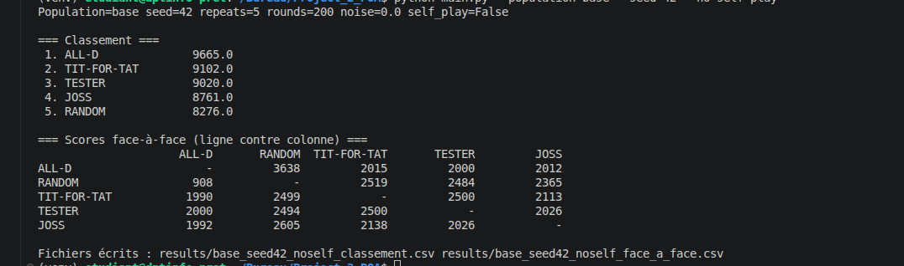

# Journal de bord – Projet 2 (HAI716I)
 
## Protocole
- Tours par partie : 200
- Parties par paire : 5
- Graine aléatoire : 42 (pour que les résultats soient reproductibles )
- Self-play : activé.
Chaque stratégie joue aussi contre son double, comme dans le tournoi d’Axelrod. Ça représente le fait qu’un agent peut rencontrer des agents qui lui ressemblent.
Ce choix compte beaucoup : les stratégies gentilles gagnent beaucoup contre elles-mêmes (TIT-FOR-TAT contre TIT-FOR-TAT = 3 000 points, coopération totale), alors qu’ALL-D gagne peu contre lui-même (2 000 points, trahison totale).
J’ai testé les deux versions :avec self-play, TIT-FOR-TAT gagne ; sans self-play, ALL-D gagne. Le gagnant dépend donc d’un simple choix de protocole.
J’ai gardé le self-play pour la suite, parce que c’est le format d’Axelrod et que la sélection (étape 3) en a besoin : une stratégie qui se multiplie rencontre forcément ses copies.

## Stratégies
 
### ALL-D
- Règle : joue D à chaque tour, quoi que fasse l'adversaire.
- Origine : C'est le choix « rationnel » du dilemme
  joué une seule fois : trahir rapporte toujours plus, quoi que fasse l'autre.
- Devrait bien jouer contre :les stratégies imprévisibles comme RANDOM,
  car il gagne 5 points chaque fois que l'autre coopère.
- Devrait mal jouer contre : les stratégies qui réagissent à la trahison comme TIT-FOR-TAT, TESTER et JOSS ,ils se laissent tromper une seule fois puis trahissent aussi. Ainsi, ALL-D ne peut plus obtenir que 2 points par tour, contre 3 points lorsque les deux joueurs coopèrent.

### RANDOM
- Règle : à chaque tour, coopère avec une probabilité de 0,5 et trahit sinon,
  sans tenir compte de l'adversaire.
- Origine : Axelrod l'avait ajoutée à son tournoi de 1980
  comme point de comparaison , c'est comme une stratégie " sans intelligence " .
- Devrait bien jouer contre : Il peut gagner quelques points
  contre les stratégies qui coopèrent (il les trahit une fois sur deux).
- Devrait mal jouer contre : ALL-D, qui l'exploite chaque fois qu'il coopère
  (0 point pour RANDOM, 5 pour ALL-D)
  
### TIT-FOR-TAT
- Règle : coopère au premier tour, puis rejoue le dernier coup de l'adversaire.
- Origine : CM4 , la plus simple du tournoi , proposée par Anatol Rapoport, gagnante du tournoi d'Axelrod
- Devrait bien jouer contre : les stratégies gentilles et contre elle-même (3 points par tour).
- Devrait mal jouer contre :ALL-D (perd le premier tour) et JOSS (une trahison surprise lance un écho de vengeance)
### TESTER
- Règle : D au premier tour. Si l'adversaire riposte (joue D), TESTER joue TIT-FOR-TAT jusqu'à la fin ; sinon il répète C, C, D.
- Origine : CM4, stratégie soumise au tournoi d'Axelrod.
- Devrait bien jouer contre :les naïfs qui ne ripostent jamais : il les trahit un tour sur trois.
- Devrait mal jouer contre : Face à TIT-FOR-TAT, il trahit au premier tour. TFT riposte, puis TESTER, devenu TFT, imite cette riposte. Les deux stratégies entrent alors dans un cycle de représailles alternées (D, C, D, C…). Face à lui-même, les deux joueurs trahissent dès le premier tour, puis reproduisent indéfiniment la trahison de l'autre.
### JOSS
- Règle : TIT-FOR-TAT, mais remplace C par D une fois sur dix.
- Origine : CM4, soumise par Johann Joss au tournoi d'Axelrod.
- Devrait bien jouer contre : RANDOM et les stratégies qui ne ripostent pas.
- Devrait mal jouer contre : TFT, TESTER et lui-même : chaque trahison surprise déclenche une riposte, puis un cycle de vengeance qui fait baisser les deux scores.

## Étape 1 – Tournoi de base
 
### Commandes
```bash
python main.py --population base --seed 42
python main.py --population base --seed 42 --no-self-play
```
### Résultats 
## avec self-play 


## sans self-play




### Question : TIT-FOR-TAT gagne-t-il ?

**Oui avec self-play, mais de peu (12 026 contre 11 557 pour ALL-D).**

**Non sans self-play : ALL-D gagne.**

TFT ne remporte aucun duel direct, mais bénéficie d'un avantage important lorsqu'elle joue contre elle-même grâce à la coopération totale (3000 points). C'est cet avantage qui lui permet de gagner avec le self-play. Sans celui-ci, ALL-D prend l'avantage grâce à ses bons résultats contre RANDOM (3527 points). Enfin, TESTER est pénalisé par sa première trahison, qui déclenche un cycle de représailles et réduit son score.


**Pourquoi c'est différent du résultat de 1980 :**
1. **La population est trop petite et peu coopérative.** Il n'y a ici que 5 stratégies, et TFT est la seule
   « gentille » (qui ne trahit jamais la première). Elle n'a presque personne avec qui coopérer.
   Dans le tournoi d'Axelrod, il y avait beaucoup plus de programmes, et beaucoup étaient gentils
2. **Le protocole compte.** Le simple fait d'inclure ou non le self-play change le gagnant.
   Le résultat d'un tournoi dépend autant des règles du tournoi que des stratégies.

## Impasses 
1. **Première version de TESTER différente du cours.** Ma première version suivait une autre
   définition (TESTER s'excusait avant de passer en TFT, et trahissait un tour sur deux contre
   un naïf). Après comparaison avec la diapositive du CM4, je l'ai corrigée. Le classement a changé :
   avec self-play, TESTER était 1er et TFT 2e ; après correction, TFT est 1er et TESTER 3e.
   Un petit détail dans la règle d'une seule stratégie suffit à changer le gagnant.
   L'ancienne version est visible dans l'historique git.
2. **GENEROUS-TFT remplacée par TF2T** à l'étape 2, car elle est présentée dans le CM4
   et le sujet demande des stratégies absentes du cours.


## Étape 2 – Nouvelles stratégies

J'ajoute deux stratégies absentes du cours. Je les ai choisies parce qu'elles pardonnent, mais de deux façons différentes ,ce qui devrait compter à l’étape 3 avec le bruit :

1. PAVLOV pardonne en réagissant à son propre résultat.
2. TF2T pardonne en tolérant une trahison isolée.

### PAVLOV (Win-Stay, Lose-Shift)
- Règle : C au premier tour. Ensuite, si le dernier tour a bien rapporté (3 ou 5 points), il rejoue
  le même coup ; sinon (0 ou 2 points), il change. Autrement dit : il coopère si les deux joueurs
  ont joué la même chose au tour précédent.
- Origine : Nowak et Sigmund (1993).
- Devrait bien jouer contre : les stratégies gentilles et lui-même (coopération totale). Après une
  erreur entre deux PAVLOV, la coopération revient en deux tours.
- Devrait mal jouer contre : ALL-D. Il perd (0 point), change pour D (2 points), considère que 2 c'est
  « perdu » donc rechange pour C… il alterne C, D, C, D et se fait exploiter un tour sur deux.

### TF2T (Tit-for-Two-Tats)
- Règle : coopère, et ne trahit que si l'adversaire a trahi aux **deux** derniers tours.
  Une trahison isolée est pardonnée.
- Origine : proposée par John Maynard Smith au second tournoi d'Axelrod.
- Devrait bien jouer contre : les stratégies gentilles, et JOSS : elle ignore ses trahisons isolées,
  donc pas de cycle de vengeance.
- Devrait mal jouer contre : les stratégies qui trahissent de temps en temps sans jamais trahir
  deux fois de suite : elle ne riposte jamais et se fait exploiter.


  ### Commande
```bash
python main.py --population etendue --seed 42
```

### Résultats


### Comparaison avec l'étape 1

1. **TIT-FOR-TAT reste premier et creuse l'écart** (18 086 contre 17 087 pour ALL-D, environ 1 000 points
   d'avance au lieu de 470). Les deux nouvelles stratégies sont gentilles : TFT gagne 3 000 points contre
   chacune, alors qu'ALL-D ne fait que 2 030 contre TF2T.

2. **TF2T est 2e, mais elle se fait exploiter.** Comme prévu dans sa fiche, elle fait mieux que TFT contre
   JOSS (2 702 contre 2 094), car elle ignore ses trahisons isolées. Mais je n'avais pas prévu sa faiblesse
   face à **TESTER** (1 995 pour TF2T, 3 670 pour TESTER). Le rythme de TESTER est C, C, D : il ne trahit
   **jamais deux fois de suite**, donc TF2T ne riposte jamais. Et comme TF2T ne joue jamais D, TESTER ne passe
   jamais en mode TFT : il l'exploite jusqu'à la fin. Même chose avec RANDOM (1 985 pour TF2T, 3 270 pour
   RANDOM). Trop pardonner coûte cher.

3. **PAVLOV n'est que 5e** à cause d'ALL-D : seulement 1 000 points (alternance C, D), alors qu'ALL-D fait
   3 500 contre lui. Comme prévu, PAVLOV est excellent avec les gentils (3 000) mais très vulnérable face
   à un traître systématique.

4. **ALL-D descend de la 2e à la 3e place**, malgré ses 3 500 points contre PAVLOV. Chaque nouvelle stratégie
   gentille profite surtout à TFT.

5. **TESTER gagne surtout grâce à TF2T** (3 670 points). Sans cette proie, il serait bien plus bas.


**Conclusion:** L'ajout de stratégies coopératives favorise TIT-FOR-TAT. Cependant, trop pardonner (TF2T) ou ne pas punir efficacement (PAVLOV face à ALL-D) peut être désavantageux face aux stratégies opportunistes. TFT doit son succès à son équilibre entre coopération et riposte immédiate. Enfin, les résultats dépendent toujours de la composition de la population.