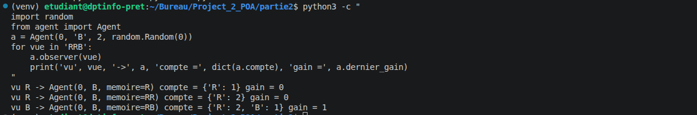

# Journal de bord – Projet 2 partie 2 (HAI716I) – Sujet B : le jeu du tee-shirt
 
## Présentation
- Sujet choisi : B, le jeu du tee-shirt. Je l'ai choisi parce qu'il ressemble à la sélection
  de la partie 1 (une population qui évolue), et que le résultat se voit bien sur des courbes.
- Principe : 100 agents portent un tee-shirt rouge ou bleu. À chaque tour, ils se rencontrent
  deux par deux au hasard et gagnent 1 point s'ils ont la même couleur. Ensuite, chacun garde
  ou change sa couleur selon sa règle. On regarde si tout le monde finit de la même couleur.
- Lien avec les systèmes multi-agents : une convention apparaît sans chef et sans que personne
  ne voie toute la population.
## Protocole
 
| Paramètre | Valeur | Pourquoi |
|---|---|---|
| Population N | 100 | nombre pair (tout le monde a un partenaire), assez grand pour une vraie population |
| Mémoire m | 10 | assez pour ne pas changer au moindre hasard, assez court pour réagir vite |
| Tours maximum | 1 000 | au-delà, on considère que la partie ne converge pas |
| Graines | 200 (0 à 199) | assez de parties pour calculer des pourcentages fiables |
| Gain | 1 si même couleur, 0 sinon | règle du cours |
| Égalité | l'agent garde sa couleur | pour ne favoriser ni le rouge ni le bleu |
| Ordre dans un tour | tout le monde observe, puis tout le monde change | pour que l'ordre des agents ne change pas le résultat |
| Convergence | les 100 agents ont la même couleur | définition du sujet |
 
**Représentation d'un agent :** sa couleur, son dernier gain, et ce qu'il a vu chez ses partenaires
de deux façons : sa **mémoire** (les m dernières couleurs seulement) et son **compte** (tout depuis le début).
 
## Règles du cours
 
### HCR (plus forte récompense cumulée)
- Règle : l'agent regarde ses 10 dernières rencontres et calcule ce que chaque couleur lui aurait
  rapporté (porter rouge gagne à chaque fois que le partenaire était rouge). Il prend la couleur
  qui aurait rapporté le plus. En pratique : la couleur qu'il a le plus vue récemment.
- Origine : CM5, Shoham et Tennenholtz.
- Devrait bien marcher : quand une couleur commence à dominer, car tous la voient souvent
  et l'adoptent vite (effet boule de neige).
- Devrait mal marcher : quand la population est très partagée (50/50), car les mémoires
  sont mélangées et les agents hésitent.
### MAJORITÉ SIMPLE
- Règle : l'agent change de couleur s'il a vu, depuis le début de la partie, plus de partenaires
  de l'autre couleur que de la sienne. Il compte tout son historique.
- Origine : CM5, Walker et Wooldridge.
- Devrait bien marcher : quand il faut de la stabilité : un peu de hasard ne le fait pas changer.
- Devrait mal marcher : quand la situation change, car il traîne tout son passé et réagit plus
  lentement que HCR.
## Étape 1 – Le jeu de base
 
### Commandes
```bash
```
 
### Résultats
 

 
### Question : quelle couleur l'emporte ?
 
 
## Étape 2 – Nouvelles règles
 
J'ajoute deux règles absentes du cours. Je les ai choisies parce que …
 
### Règle 3 : …
- Règle :
- Origine :
- Devrait bien marcher :
- Devrait mal marcher :
### Règle 4 : …
- Règle :
- Origine :
- Devrait bien marcher :
- Devrait mal marcher :
### Commande
```bash
```
 
### Résultats
 

 
### Comparaison avec l'étape 1
- La plus rapide :
- La plus sûre :
**Conclusion :**
 
 
## Étape 3 – Modifications du jeu
 
Je garde les mêmes règles et le même protocole, et je ne change qu'un élément du jeu à la fois.
Je compare chaque résultat avec l'étape 1 et l'étape 2 : comme une seule chose change,
c'est elle qui explique les différences.
 
### Modification 1 : …
 
**Ce que ça change :**
 
**Pourquoi ce choix :**
 
**Prédiction (écrite AVANT de lancer) :**
 
**Commande :**
```bash
```
 
**Résultat :**
 

 
**Écart et explication :**
 
**Ce que j'avais bien prédit :**
 
**Ce que j'avais mal prédit :**
 
**Ce que j'en retiens :**
 
 
### Modification 2 : …
 
**Ce que ça change :**
 
**Pourquoi ce choix :**
 
**Prédiction (écrite AVANT de lancer) :**
 
**Commande :**
```bash
```
 
**Résultat :**
 

 
**Écart et explication :**
 
**Ce que j'avais bien prédit :**
 
**Ce que j'avais mal prédit :**
 
**Ce que j'en retiens :**
 
 
## Impasses
1. **Repartir de zéro.** J'ai d'abord récupéré un code complet généré d'un coup, puis je me suis perdu
   (branche git en trop, code pas compris, ancien code poussé par erreur). J'ai supprimé cette première
   version et reconstruit le code étape par étape (agent, règles, jeu, expériences) pour le comprendre.
## Conclusion
 
 
## Utilisation de l'IA
Le code et une partie de la rédaction de ce journal ont été faits avec l'aide d'une IA générative.
J'ai reconstruit le code étape par étape, relu, testé, vérifié des cas à la main,
et lancé moi-même toutes les expériences.
 
 
## Vérification à la main
- **Mémoire de l'agent :** un agent BLEU avec une mémoire de 2 voit R, R, B. À la fin, sa mémoire contient
  R, B (le premier R est sorti), mais son compte garde R = 2, B = 1. Son dernier gain vaut 1.
  
- **HCR :** un agent BLEU a vu R, R, B. Porter rouge lui aurait rapporté 2 points, porter bleu 1 point :
  il passe ROUGE.
 
